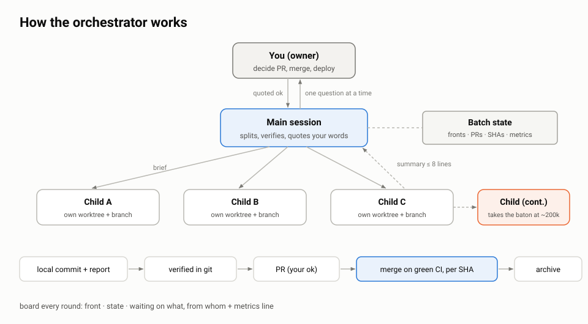
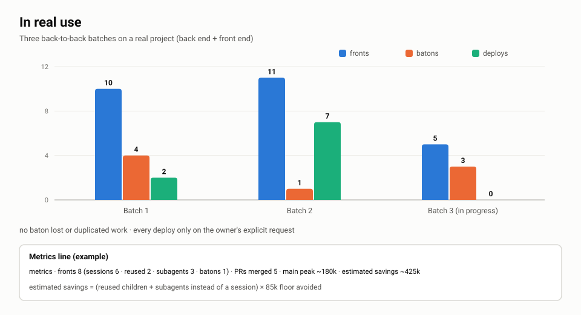
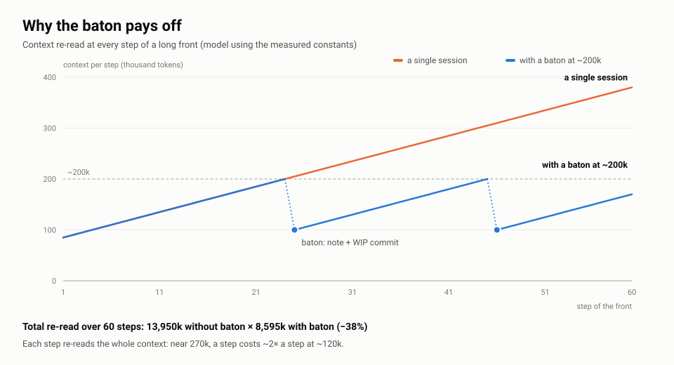

# orquestrador / orchestrator

English · [Português](README.md)

A skill for the **Claude desktop app (Code tab)** that turns one session into the **manager of a
batch of work**. It splits your request into independent fronts, opens a child session for each,
tracks all of them and brings you only what needs your decision.

You talk to **one** session. The children work in parallel, each in its own worktree, and never
talk to you directly.

> Two editions of the same skill: **`orchestrator`** (English, `en/`) and **`orquestrador`**
> (Portuguese, `skills/`). Install only one of them.



## Why use it

- **Many requests at once, without losing track.** A list of 5–10 asks becomes parallel fronts.
  The main session keeps a state file with each front's owner, branch, PR, dependencies and your
  decisions. If the conversation drops, it resumes from that file.
- **Context that doesn't blow up.** When a child reaches ~200k tokens, it hands the "baton" to a new
  session through the skill's protocol: handoff note, WIP commit, one owner per front. No work is
  duplicated or lost. Measured: near 270k, each step costs twice as much as a step at ~120k.
- **Cost under control.** Every new session pays a floor of ~85k tokens. So the skill decides what
  becomes a session, what becomes a subagent, and when to reuse an idle child on the same topic.
  Each front gets a model and effort fit for the task: code that needs decisions stays on the main
  session's model (medium effort when the design is already settled), analysis and mechanical
  writing already decided go to Sonnet, sweeps to Haiku. You see each front's choice when the
  batch opens.
- **No trial-and-error loops.** After two failed attempts at the same thing, the child stops and
  escalates with what it tried, the error and its hypothesis.
- **You approve, and nobody approves for you.** PR, merge, migration and deploy happen only with
  your ok, and the main session quotes your words when it passes a decision on. A child's message
  never counts as approval. A merge ok covers a closed list of PRs **pinned to their SHA** at that
  moment: a push after the ok needs a new check.
- **Safe merges.** The main session merges only with green CI and no conflict, in dependency order.
  A conflict goes back to the owning child as a `git merge` from production, never a rebase or
  force-push.
- **"Done" is verified.** Every child's delivery is checked in git/GitHub before it reaches you.
- **A board every round.** Every reply from the main session ends with one line per front (state
  and who waits on what), so no front drops out of sight by going quiet.
- **Decisions in a queue, not in a wall of text.** With 6 to 8 children, results don't land in the
  conversation whole. Everything that needs your decision becomes a numbered item (D1, D2...) at the
  top of the reply. With the plugin, the band shows **one decision at a time**, as a card:
  ```
  🎼 decision 1 of 3 · D1 · front date-filter                       [next ›]
     Should the filter include the whole end day (until 23:59)?
     today it cuts at midnight; 3 reports change
     [yes] [no] [answer…]
  ```
  A button only **fills the prompt** (`D1: yes`). You send it with Enter, so the answer is still
  yours. A decision leaves the queue only after you answer.
- **Guards against mistakes seen in real use** (with the plugin, main session only):
  - your `D3: …` answer arrives with a reminder for the main session to pass it to the child **in
    the same turn**; if the decision stays queued, the band flags it in yellow;
  - `gh pr merge --auto` is refused: with no required check in the repository, it merges at once
    without waiting for CI. Merges go through the script that waits for checks and pins the
    approved SHA;
  - with `--repos`, the band warns when another active batch merges or deploys in the same
    repository, and the main session checks the server and main before each merge or deploy.
- **Simple metrics every round.** Installed as a plugin, the main session gets a band above the
  prompt, refreshed at the end of every turn:
  ```
  🎼 orchestrator · fronts 2 · sessions 3 · batons 1 · PRs 0 · peak ~162k · estimated savings ~2,500k
     floor avoided ~0k (0 reused + 0 subagents) · baton ~2,500k (1 handoff)
  ```
  The same math closes every round's board as a text line, which also works without the plugin.
  The savings are an **estimate** in two parts:
  - **floor avoided:** each reused child or subagent used instead of a session counts the ~85k a
    new session would pay;
  - **baton:** `(context at handoff − successor's starting context) × successor's steps`, that is,
    the context no longer re-read at every step.

  - **automatic compaction of the main session:** at 200k of context, the band compacts the main
    session at the end of the turn, with instructions that keep the batch state and skill paths.
    It stays the same session, so the children's notices keep arriving. Children never compact:
    they hand the baton to a new session.

  Nothing runs in other sessions: the band only shows in the main session that recorded metrics, and
  goes away with `metricas.mjs fim` at the end of the batch.
- **Learns from use.** Each batch ends with a retrospective, and what went wrong becomes a new line
  in `pitfalls.md`, with your ok.

### In real use

Three back-to-back batches on a real project (back end + front end), the third still in progress:



- 26 fronts, across fixes, features, analyses and tests;
- 8 context handoffs, with no work lost or duplicated;
- 9 deploys, each one only on the owner's explicit request, always back end before front end;
- analysis fronts running on a cheaper model.

### Why the baton pays off

Every step of a session re-reads its whole context, so the cost of a step grows with it. Handing
the front to a new session near 200k keeps each step cheap. In the model below, using the measured
constants (~85k floor, a step at 270k costing ~2× a step at 120k), a 60-step front re-reads **38%
less** context with batons. It is a model, not a measurement of a specific batch.



## Requirements

- **Claude desktop app, Code tab**, for full orchestration. The skill relies on the app's session
  tools (`start_session`, `SendMessage`, `get_session`, `list_events`, `archive_session`). Outside
  it, see "Claude and Codex" above.
- `git`. An authenticated `gh` if you want PRs and merges on GitHub.

## Claude and Codex

| | Claude desktop (Code tab) | Claude Code in the terminal (CLI) | Codex |
|---|---|---|---|
| Reads the skill | yes | yes | yes (`~/.codex/skills/`) |
| Opens and drives child sessions by itself | **yes** | no | no |
| Automatic context handoff | **yes** | no | no |
| Batch state, briefs, SHA-pinned merge, pitfalls | yes | yes (manual) | yes (manual) |
| How to call it | `/orchestrator` | `/orchestrator` | `$orchestrator`, or ask "use the orchestrator skill" |

**Full orchestration works only in the Claude desktop app**, because the skill depends on session
tools that exist only there. In the CLI and in Codex it still works as a **manual method**: the
main session splits the fronts, writes the batch state and drafts one brief per front. You open
each session and paste its brief. The rules for PRs, SHA-pinned merges, verifying "done" and the
pitfalls still apply. In Codex, `disable-model-invocation` has no effect, so it may suggest the
skill on its own.

## Install

**As a plugin (recommended):**

```
/plugin marketplace add fcoluiz/orquestrador
/plugin install orchestrator@orquestrador
```

(For the Portuguese edition: `/plugin install orquestrador@orquestrador`.)

The same from a terminal, outside a session:

```
claude plugin marketplace add fcoluiz/orquestrador
```
```
claude plugin install orchestrator@orquestrador
```

**Manually (Claude):** copy `en/skills/orchestrator/` to `~/.claude/skills/orchestrator/`.

**Codex (manual mode):** copy the same folder to `~/.codex/skills/orchestrator/`.

From a terminal (Git Bash, macOS or Linux):

```
git clone https://github.com/fcoluiz/orquestrador.git
```
```
cp -r orquestrador/en/skills/orchestrator ~/.claude/skills/
```
```
cp -r orquestrador/en/skills/orchestrator ~/.codex/skills/
```

**Update:** `claude plugin update orchestrator@orquestrador` (or `git pull` and copy again).

## Usage

The skill **does not trigger by itself** (`disable-model-invocation`). Call it with your requests:

```
/orchestrator
1 - fix the date-range filter in reports
2 - "All" tab visible to admins only
3 - estimate the cost of transcribing videos (analysis only)
```

When installed as a plugin, the command also shows up as `/orchestrator:orchestrator`.

What happens:

1. The main session picks a notes folder outside the repos and creates the **batch state** file.
2. It suggests a permission allowlist so children don't stall on routine commands. It is applied
   only with your ok.
3. It splits the requests into fronts that don't touch the same files and opens the sessions, at
   most 6 active. The rest wait in a queue.
4. Each child works in its own worktree and delivers a local commit, a report file and a summary
   of up to 8 lines.
5. The main session verifies the work, then asks for your ok for PRs, then for the merge and, if
   you ask, for the deploy.
6. Finished sessions are archived in bulk. The batch ends with the retrospective.

**Tip:** don't click the "(cont.)" cards that show up. The main session starts them itself, at the
right point of the handoff protocol.

## Lifecycle of a front

```
brief → work (local commit + report) → verification → PR (your ok)
      → merge on green CI (your ok, per SHA) → deploy (only if asked) → archive
                 ↘ context ~200k: baton handoff to a "(cont.)" session
```

## Layout

English edition, in `en/skills/orchestrator/` (the Portuguese one in `skills/orquestrador/` has
the same files under Portuguese names):

| File | Purpose | Read by |
|---|---|---|
| `SKILL.md` | Main-session rules, lifecycle, context economy | main |
| `references/app-limits.md` | App limits that shape the design | main |
| `references/child-brief.md` | Template for each child's brief | main |
| `references/baton.md` | Context handoff (baton) protocol | main and children |
| `references/batch-state.md` | Batch state file template | main |
| `references/merge-ci.md` | PR, SHA-pinned merge, CI, deploy | main |
| `references/permissions.md` | Suggested allowlist (apply only with ok) | main |
| `references/pitfalls.md` | Pitfalls seen in practice | main |

## Limitations

- The app limits were observed in November 2026 and may change with new versions. They are
  documented in `app-limits.md`.
- The "Experimental" section of `app-limits.md` (starting the continuation without waiting for
  your message) is optional and unconfirmed. Without it, the skill works with cards.

## License

MIT
