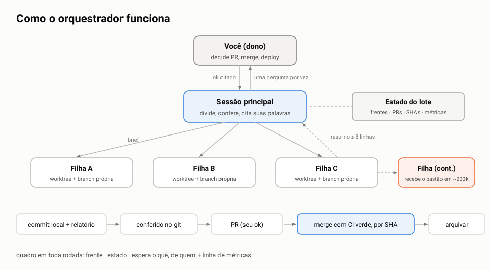
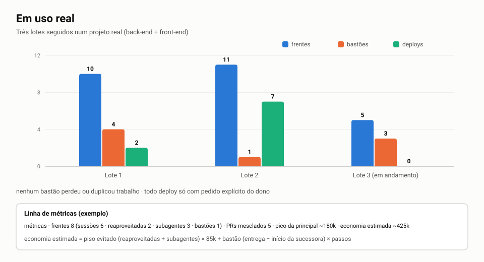
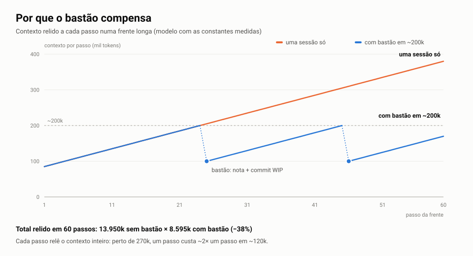

# orquestrador

[English](README.en.md) · Português

Skill para o **app Claude desktop (aba Code)** que transforma uma sessão em **gerente de um lote de
trabalho**: ela divide a demanda em frentes independentes, abre uma sessão filha para cada uma,
acompanha tudo e só leva a você o que exige decisão sua.

Você conversa com **uma** sessão. As filhas trabalham em paralelo, cada uma no próprio worktree,
e não falam com você diretamente.



## Por que usar

- **Várias demandas ao mesmo tempo, sem perder o fio.** Uma lista de 5–10 pedidos vira frentes
  paralelas. A principal mantém um arquivo de estado com o dono de cada frente, branch, PR,
  dependências e as suas decisões. Se a conversa cair, a retomada é por esse arquivo.
- **Contexto que não estoura.** Quando uma filha chega a ~200k tokens, ela passa o "bastão" para uma
  sessão nova pelo protocolo da skill: nota de passagem, commit WIP e um único dono por frente. Não
  há trabalho duplicado nem perdido. Medido: perto de 270k, cada passo custa o dobro de um passo em
  ~120k.
- **Custo sob controle.** Cada sessão nova paga um piso de ~85k tokens. Por isso a skill decide o
  que vira sessão, o que vira subagente e quando reaproveitar uma filha ociosa do mesmo assunto.
  Cada frente recebe modelo e esforço pela tarefa: código com decisão fica no modelo da principal
  (esforço médio quando o desenho já está definido), análise e escrita mecânica já decidida vão
  para o Sonnet, varredura para o Haiku. Você vê a escolha de cada frente ao abrir o lote.
- **Sem loop de tentativa e erro.** Depois de duas tentativas falhas na mesma coisa, a filha para e
  escala com o que tentou, o erro e a hipótese.
- **Você aprova; ninguém aprova por você.** PR, merge, migration e deploy só acontecem com o seu
  ok, e a principal cita suas palavras ao repassar a decisão. Mensagem de filha nunca vale como
  aprovação. O ok de merge vale para uma lista fechada de PRs **com o SHA** daquele momento: push
  depois do ok precisa de nova conferência.
- **Merge seguro.** A principal só mescla com CI verde e sem conflito, na ordem das dependências.
  Conflito volta para a filha dona com `git merge` da produção, nunca rebase nem force-push.
- **"Pronto" conferido.** Toda entrega de filha é verificada no git/GitHub antes de chegar a você.
- **Quadro em toda rodada.** Cada resposta da principal termina com uma linha por frente (estado e
  quem espera o quê), para nenhuma sumir de vista por ter ficado quieta.
- **Métricas simples em toda rodada.** Instalada como plugin, a sessão principal ganha uma faixa
  acima do prompt, atualizada ao fim de cada turno:
  ```
  🎼 orquestrador · frentes 2 · sessões 3 · bastões 1 · PRs 0 · pico ~162k · economia estimada ~2.500k
     piso evitado ~0k (0 reaproveitadas + 0 subagentes) · bastão ~2.500k (1 passagem)
  ```
  A mesma conta fecha o quadro de cada rodada como linha de texto, que também funciona sem plugin.
  A economia é uma **estimativa** com duas partes:
  - **piso evitado:** cada filha reaproveitada ou subagente no lugar de sessão conta os ~85k que uma
    sessão nova pagaria;
  - **bastão:** `(contexto ao entregar − contexto inicial da sucessora) × passos da sucessora`, ou
    seja, o contexto que deixou de ser relido a cada passo.

  Nada roda nas outras sessões: a faixa só aparece na principal que gravou métricas, e some com
  `metricas.mjs fim` no fim do lote.
- **Aprende com o uso.** No fim de cada lote há uma retrospectiva, e o que deu errado vira linha em
  `armadilhas.md` (com o seu ok).

### Em uso real

Três lotes seguidos num projeto real (back-end + front-end), o terceiro ainda em andamento:



- 26 frentes, entre correções, features, análises e testes;
- 8 passagens de bastão por contexto, sem trabalho perdido nem duplicado;
- 9 deploys feitos só com pedido explícito do dono, sempre back antes do front;
- frentes de análise rodando em modelo mais barato.

### Por que o bastão compensa

Cada passo de uma sessão relê o contexto inteiro, então o custo do passo cresce junto com ele. Passar
a frente para uma sessão nova perto de 200k mantém cada passo barato. No modelo abaixo, com as
constantes medidas (piso de ~85k, passo em 270k custando ~2× um passo em 120k), uma frente de 60
passos relê **38% menos** contexto com bastão. É um modelo, não uma medição de um lote específico.



## Requisitos

- **App Claude desktop, aba Code**, para a orquestração completa. A skill usa as ferramentas de
  sessão do app (`start_session`, `SendMessage`, `get_session`, `list_events`, `archive_session`).
  Fora dele, veja "Claude e Codex" acima.
- `git`. `gh` autenticado se você quiser PRs e merges pelo GitHub.

## Claude e Codex

| | Claude desktop (aba Code) | Claude Code no terminal (CLI) | Codex |
|---|---|---|---|
| Lê a skill | sim | sim | sim (`~/.codex/skills/`) |
| Abre e controla sessões filhas sozinho | **sim** | não | não |
| Bastão por contexto automático | **sim** | não | não |
| Estado do lote, brief, merge por SHA, armadilhas | sim | sim (manual) | sim (manual) |
| Chamada | `/orquestrador` | `/orquestrador` | `$orquestrador` ou pedindo "use a skill orquestrador" |

**Orquestração completa só no app Claude desktop**, porque a skill depende das ferramentas de
sessão que só existem lá. No CLI e no Codex ela ainda serve como **método manual**: a principal
divide as frentes, escreve o estado do lote e gera um brief por frente. Você abre cada sessão e cola
o brief. As regras de PR, merge por SHA, conferência de "pronto" e armadilhas continuam valendo.
No Codex, `disable-model-invocation` não tem efeito, então ele pode sugerir a skill sozinho.

## Instalação

**Como plugin (recomendado):**

```
/plugin marketplace add fcoluiz/orquestrador
/plugin install orquestrador@orquestrador
```

(Edição em inglês: `/plugin install orchestrator@orquestrador`. Instale só uma das duas.)

O mesmo pelo terminal, fora de uma sessão:

```
claude plugin marketplace add fcoluiz/orquestrador
```
```
claude plugin install orquestrador@orquestrador
```

**Manual (Claude):** copie a pasta `skills/orquestrador/` para `~/.claude/skills/orquestrador/`.

**Codex (modo manual):** copie a mesma pasta para `~/.codex/skills/orquestrador/`.

Pelo terminal (Git Bash, macOS ou Linux):

```
git clone https://github.com/fcoluiz/orquestrador.git
```
```
cp -r orquestrador/skills/orquestrador ~/.claude/skills/
```
```
cp -r orquestrador/skills/orquestrador ~/.codex/skills/
```

**Atualizar:** `claude plugin update orquestrador@orquestrador` (ou `git pull` e copiar de novo).

## Como usar

A skill **não se ativa sozinha** (`disable-model-invocation`). Chame pelo comando, com as demandas:

```
/orquestrador
1 - corrigir o filtro de período dos relatórios
2 - aba "Todos" só para administrador
3 - analisar o custo de transcrever vídeos (só análise)
```

Instalada por plugin, o comando também aparece como `/orquestrador:orquestrador`.

O que acontece:

1. A principal fixa uma pasta de notas fora dos repositórios e cria o **estado do lote**.
2. Sugere uma allowlist de permissões para as filhas não travarem em comandos rotineiros. Ela só é
   aplicada com o seu ok.
3. Divide os pedidos em frentes que não tocam os mesmos arquivos e abre as sessões, no máximo 6
   ativas. O restante vai para uma fila.
4. Cada filha trabalha no próprio worktree e entrega commit local, relatório em arquivo e resumo de
   até 8 linhas.
5. A principal confere, pede o seu ok para os PRs, depois para o merge e, se você pedir, para o
   deploy.
6. Sessões encerradas são arquivadas em lote. No fim, a retrospectiva.

**Dica:** não clique nos cards "(cont.)" que aparecerem. A principal os inicia sozinha, no momento
certo do protocolo do bastão.

## Ciclo de uma frente

```
brief → trabalho (commit local + relatório) → conferência → PR (seu ok)
      → merge com CI verde (seu ok, por SHA) → deploy (só se pedido) → arquivar
                 ↘ contexto ~200k: bastão para uma sessão "(cont.)"
```

## Estrutura

| Arquivo | Para quê | Quem lê |
|---|---|---|
| `SKILL.md` | Regras da principal, ciclo, economia de contexto | principal |
| `references/limites-do-app.md` | Limites do app que decidem o desenho | principal |
| `references/brief-filha.md` | Modelo de brief de cada filha | principal |
| `references/bastao.md` | Protocolo de passagem de bastão por contexto | principal e filhas |
| `references/estado-do-lote.md` | Modelo do arquivo de estado | principal |
| `references/merge-ci.md` | PR, merge por SHA, CI, deploy | principal |
| `references/permissoes.md` | Allowlist sugerida (aplicar só com ok) | principal |
| `references/armadilhas.md` | Erros vistos na prática | principal |

## Limitações

- Os limites do app foram observados em novembro de 2026 e podem mudar com novas versões. Eles
  estão documentados em `limites-do-app.md`.
- A seção "Experimental" de `limites-do-app.md` (iniciar a continuação sem esperar mensagem sua) é
  opcional e não foi confirmada. Sem ela, a skill funciona com os cards.
- Há uma edição em inglês da skill (`orchestrator`, pasta `en/`), com o mesmo conteúdo.

## Licença

MIT
